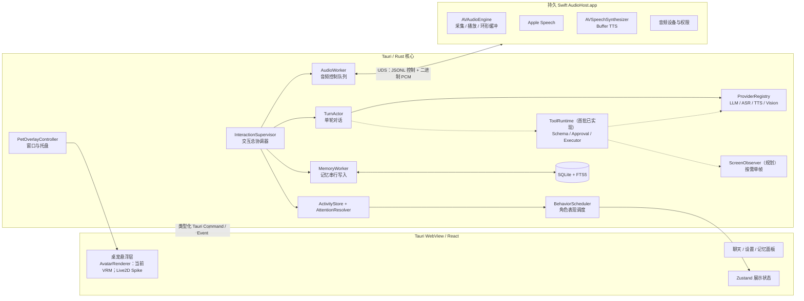
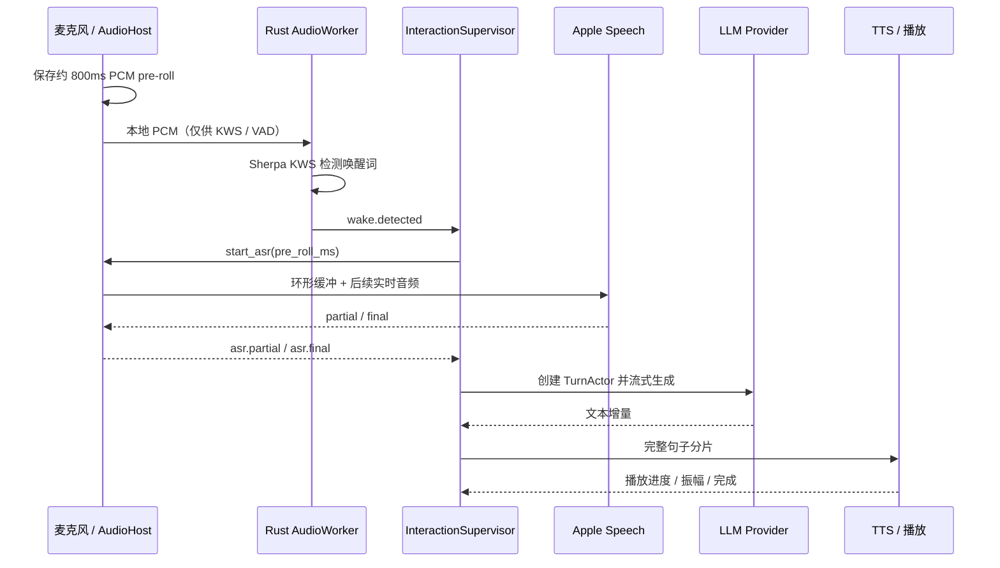
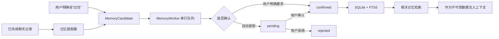

# Desktop AI Companion 内部技术架构

> 版本：v0.4 实现基线
>
> 状态：核心 MVP 已进入编码；工具运行时首批网页/提醒切片已落地，屏幕感知等高风险能力仍需单独 Spike
>
> 更新日期：2026-08-28

## 1. 文档目标

本文定义 MVP 内部各组件的职责、进程边界、通信方式、状态管理、语音链路、记忆流程和桌宠交互组织方式，并为后续工具调用与按需屏幕感知保留受控扩展点。

这份文档解决的是“各技术如何协作”。可执行细节见 [`implementation/README.md`](implementation/README.md)；屏幕数据出站、细粒度采集和系统通知的实机行为仍需完成对应评审与 Spike。

### MVP 架构目标

- 桌宠窗口、聊天界面、语音链路和记忆管理具有清晰的数据所有权。
- 一次对话可以被可靠地启动、打断、取消和恢复，迟到事件不会污染新对话。
- 持续监听只在本地完成唤醒检测，唤醒前音频不进入云端服务。
- 记忆写入可追溯、可确认、可撤销，角色核心设定不会被普通对话覆盖。
- 角色表现由统一状态派生，业务模块不能直接争抢动画和表情控制权。
- 后续工具能力经过统一 schema、权限策略和审计，模型不能直接访问系统 API。

### MVP 非目标

- 多角色同时运行。
- 跨设备同步和云端记忆。
- 向量数据库、复杂自治规划和长期后台任务。
- 完整换装和通用 GUI 自动化。
- 内置工具执行与按需屏幕理解不进入当前核心 MVP，按照 [`tools-and-vision.md`](tools-and-vision.md) 作为后续 Tool MVP。

## 2. 总体结构



核心原则是：**Rust 核心保存业务事实，Swift AudioHost 保存瞬时音频状态，React 只保存可重建的展示状态，SQLite 保存持久数据。**

## 3. 进程与模块边界

### 3.1 React / Tauri WebView

负责：

- AvatarRenderer 的角色展示；当前实现为 VRM，Live2D 仅作为候选渲染后端进行 Spike。
- 角色动画混合、表情、视线和口型展示；业务模块不直接调用具体 VRM/Live2D SDK。
- 桌宠气泡、聊天、设置、记忆管理和活动列表界面。
- 用户点击、拖动、快捷操作等 UI 意图上报。
- 缓存后端状态的只读投影；重载后可从 Rust 快照恢复。

不负责：

- 对话编排、记忆决策、密钥保存、音频设备控制。
- 将 UI 状态当作对话或权限状态的唯一事实来源。

### 3.2 Tauri / Rust 核心

Rust 是应用业务状态的唯一事实来源，主要模块如下：

- `InteractionSupervisor`：唯一交互总协调器；创建和取消对话轮次，协调音频、模型、记忆与展示状态。
- `TurnActor`：每轮对话一个实例；管理上下文准备、LLM 流、句子切分、TTS 投递和完成状态。
- `AudioWorker`：串行处理音频控制请求，维护 AudioHost 连接、唤醒词、VAD、ASR 和播放会话。
- `MemoryWorker`：记忆唯一写入口；串行执行候选合并、确认、修改、删除和索引更新。
- `ProviderRegistry`：隔离 LLM、ASR、TTS 和 Vision Provider；Provider 不直接修改 UI、工具权限或数据库。
- `ToolRuntime`（首批已实现）：校验、授权和执行 `system.open_url`/`timer.create`/`timer.cancel`/`memory.save`/本地 `screen.observe`，并把结果回传当前 `TurnActor`；当前每次只接受一个模型 ToolCall，每轮最多连续 3 步，详细方案见 [`tools-and-vision.md`](tools-and-vision.md)。
- `ScreenObserver`：按需捕获显示器画面，管理进程内临时截图、macOS 本地 OCR 和经二次确认的 Vision Provider 路由；不等同于 GUI 自动化。窗口/区域选择仍是后续能力。
- `ActivityStore`：记录需要呈现给用户的当前活动、结果和阻塞项。
- `AttentionResolver`：按优先级从多个活动中选出桌宠当前应该表达的状态。
- `BehaviorScheduler`：把语义状态转换为动作、表情、视线、口型和气泡提示。
- `PetOverlayController`：管理桌宠悬浮窗口、主面板、托盘、快捷键、位置和鼠标穿透。

MVP 同一时间只允许一个前台 `TurnActor`。记忆整理可以在该轮完成后异步执行，但被取消或未完成的轮次不得自动提交长期记忆。

### 3.3 Swift AudioHost.app

AudioHost 是随主应用启动和退出的持久辅助进程，而不是每次识别临时启动的脚本。它负责：

- 麦克风权限、音频设备变化和 `AVAudioEngine` 生命周期。
- 麦克风 PCM 采集、约 800ms pre-roll 环形缓冲和音频播放。
- Apple Speech 会话及 `partial / final` 结果。
- `AVSpeechSynthesizer.write(_:toBufferCallback:)` 生成音频缓冲。
- 向 Rust 报告播放进度、振幅包络、设备与权限状态。

AudioHost 不理解角色、LLM、记忆或业务页面。其崩溃只影响语音能力，不应导致聊天和记忆数据损坏。

## 4. 数据所有权与同步

| 数据 | 唯一事实来源 | 其他层的职责 |
| --- | --- | --- |
| 当前对话轮次、取消代次 | Rust `InteractionSupervisor` | React 展示投影；AudioHost 执行带代次的命令 |
| 麦克风、ASR、播放实时状态 | Swift AudioHost，Rust 保存已确认快照 | React 只展示 Rust 发布的状态 |
| 聊天记录、记忆、角色配置 | SQLite，经 Rust Repository 访问 | React 不直连数据库；AudioHost 不读取数据库 |
| 桌宠位置、尺寸、显示器、可见性 | Rust 配置存储 | React 提交意图，窗口控制器应用并回报 |
| 动作、表情、口型 | Rust 派生语义状态；React 执行渲染 | 动画完成事件可回传，但不能反向改写业务状态 |
| API Key | 发布/设置页使用 macOS Keychain，经 Rust 访问；开发模式可用被 Git 忽略的 `.env` | 不进入前端持久存储、日志或 SQLite |
| 工具定义、授权策略、运行记录 | Rust `ToolRuntime` / SQLite | 模型只能提出结构化调用，不能绕过策略直接执行 |
| 临时屏幕快照 | Rust `ScreenObserver` | 按 TTL 删除；默认不进入聊天、记忆或诊断日志 |

聊天、语音、视觉等 Provider 的凭据按用途保存为独立 Keychain 条目。用户可以主动选择复用同一凭据，但代码不得默认把聊天 Key 暴露给视觉或外部工具。

UI 启动或重载时先请求完整 `AppSnapshot`，之后消费增量事件。若发现事件序号断裂，UI 丢弃本地投影并重新拉取快照，不尝试自行补状态。

## 5. 状态模型

避免使用一个巨大枚举表达所有组合。MVP 采用四组相互正交的全局状态，并为活动 turn 保留生成子状态：

```text
ListeningMode: Disabled | Armed | QuietHours
InputState:    Stopped | WakeListening | Capturing | Recognizing | Recovering
TurnState:     Idle | Preparing | Active | Finalizing | Completed | Cancelled | Failed
PlaybackState: Idle | Buffering | Playing | Stopping | Failed
GenerationState: NotStarted | Streaming | Finished | Failed
```

- `ListeningMode` 表示用户授权与产品模式。
- `InputState` 表示麦克风到识别文本的实时阶段。
- `TurnState` 表示一次文字或语音对话的业务生命周期。
- `PlaybackState` 表示 TTS 队列与扬声器状态。
- `GenerationState` 属于当前 turn，用于表达 LLM 仍在生成、TTS 已经播放的并行情况，不是第五个全局单例状态。

桌宠的 `idle / listening / thinking / speaking / sleeping / needs-input / ready / recovering / error` 是以上状态与活动信息的**派生结果**，不是另一套可被任意模块写入的业务事实；缺少专用动画时由 VRM runtime 回退到 idle + 表情。

后续每个工具调用另有独立状态：`Proposed | AwaitingApproval | Running | Succeeded | Cancelled | Failed | Denied`。它属于当前 `TurnActor`，不扩展为第五个全局单例状态机。

完整转移、守卫、终态与表现状态派生见 [`implementation/state-machines.md`](implementation/state-machines.md)。

### 代次与迟到事件

所有跨模块消息都携带：

- `schema_version`
- `session_id`
- `turn_id`（与具体对话轮次相关时）
- `generation`（取消代次）
- `sequence` 或 `request_id`

取消顺序固定为：先递增 `generation`，再广播取消，最后清空对应队列。任何旧 `generation` 的 ASR、LLM、TTS 或 UI 事件都直接丢弃。这样可以避免上一轮的迟到结果进入下一轮。

## 6. 通信协议

### 6.1 React 与 Rust

- Tauri Command：用户意图和需要返回值的低频请求，例如开始对话、停止朗读、确认记忆、修改设置。
- Tauri Event：后端状态、流式文本、活动变化和错误通知。
- 不使用内部 WebSocket；只有外部 Provider 明确需要时才使用 HTTP/SSE/WebSocket。
- 原始 PCM、逐采样振幅等高频数据不得经过 Tauri JSON Event。
- LLM token 在 Rust 内按时间或字符阈值合并，再批量推送 UI，减少 WebView 事件压力。

统一事件信封示例：

```json
{
  "schema_version": 1,
  "event_id": "01J...",
  "session_id": "session-...",
  "turn_id": "turn-...",
  "generation": 4,
  "sequence": 12,
  "type": "turn.delta",
  "payload": {}
}
```

### 6.2 Rust 与 AudioHost

使用当前用户私有的 Unix Domain Socket：

- 控制通道：UTF-8 JSON Lines，传输握手、开始/停止、Provider 参数、状态、错误和心跳。
- 媒体通道：长度前缀的二进制帧，传输 PCM 和必要的振幅数据。
- Socket 文件权限设为当前用户可读写；连接握手校验协议版本、会话随机令牌和能力列表。
- AudioHost 断线后由 Rust 限次重启并重建状态；重连前所有旧会话失效。

控制协议与媒体协议必须独立版本化。不得把 PCM 编码进 JSON 或 Base64 长消息。

完整 command/event、握手、帧头、背压和错误码见 [`implementation/ipc-protocol.md`](implementation/ipc-protocol.md)。

## 7. 语音交互流程

### 7.1 唤醒与识别

下图是接入 PCM media socket 与 Rust KWS/VAD 后的目标链路。当前可运行切片使用 AudioHost 内 Apple Speech 设备端识别检测“爱丽丝”及少量中文同音变体，差异见 [`implementation/status.md`](implementation/status.md)；设备端能力不可用时持续监听会被拒绝，不会把唤醒前环境音发送到在线 ASR。



具体规则：

1. `Armed` 模式下 AudioHost 持续采集，但唤醒前只把音频送到本机 Rust KWS/VAD，绝不发送给 LLM 或云端 ASR。
2. AudioHost 保存约 800ms pre-roll。Rust 检测到唤醒后发送 `asr.start(pre_roll_ms)`，Apple Speech 先消费宿主本地缓冲再接实时音频，避免把 PCM 往返传输并吞掉首字。
3. `partial` 只用于字幕和端点辅助，不能写入聊天记录或长期记忆。
4. `final`、VAD 端点、超时和用户手动结束共同决定本轮输入封口；只有封口文本进入 LLM。
5. Apple Speech 是否完全本地取决于系统、语言和设备能力，产品界面必须区分“本地唤醒”和“识别可能使用系统在线服务”。

### 7.2 TTS、口型与文本一致性

- `TurnActor` 对 LLM 输出做安全的句子切分，完整句子才进入 TTS 队列。
- TTS Provider 接口允许有界预生成多个分片，但播放严格按 `chunk_sequence` 排序；Apple Provider 初始并发设为 1，验证稳定后再提高。
- AudioHost 从语音缓冲计算振幅包络，Rust 将其降采样后发送给 React 驱动基础口型。
- 每轮分别记录 `canonical_text`、`display_text` 和 `spoken_text`，避免字幕/发音处理污染记忆来源，也避免把未说出的内容标记为已朗读。
- 停止时立即失效当前 `generation`，清空未播放分片，并把当前消息标记为 `interrupted`。

### 7.3 打断策略

MVP 必须保证快捷键、点击和托盘命令可以立即停止 TTS 并开启新一轮输入。

“角色说话时用自然语音打断”需要回声消除，否则扬声器声音可能触发 VAD、唤醒词或 ASR。实施前先完成 `VoiceProcessingIO` / AEC 可行性验证：

1. 播放期间检测到疑似人声后先降低 TTS 音量。
2. 短窗口内二次确认来自麦克风的人声或有效识别片段。
3. 确认后递增代次、停止播放并切入输入状态。

如果 AEC 在目标设备上不稳定，MVP 关闭“播放中语音打断”，保留快捷键和点击打断，不伪装成已经解决。

AudioHost 的进程、线程、权限、Apple Speech 滚动、TTS 与崩溃恢复规格见 [`implementation/audio-host.md`](implementation/audio-host.md)，端到端时序见 [`implementation/sequences.md`](implementation/sequences.md)。

## 8. 对话与 Provider 编排

一次前台轮次遵循：

```text
用户输入
  -> 输入封口
  -> 检索已确认记忆
  -> 组装角色核心设定 + 会话上下文 + 记忆数据
  -> LLM 流式生成
  -> 可选：提出工具调用 -> 校验/授权/执行 -> 回传工具结果 -> 继续生成
  -> UI 批量增量 + 句子 TTS
  -> 完成或取消
  -> 保存聊天记录
  -> 异步生成记忆候选
```

- Provider 只暴露能力与会话接口，不参与窗口、角色动作、工具授权或数据库事务。
- LLM、ASR、TTS 和 Vision 请求均接收取消令牌、超时和 `generation`。
- Provider 错误转换为统一错误类型，再由 `InteractionSupervisor` 决定重试、降级或提示用户。
- 本地与云端 Provider 使用相同上层事件，不让 UI 感知供应商差异。

Provider 的接口、流事件、超时、重试与合同测试见 [`implementation/providers.md`](implementation/providers.md)。

## 9. 记忆生命周期



### 9.1 记忆类型与状态

MVP 记忆范围：

- `user_global`：用户稳定信息与偏好。
- `character_relationship`：用户与当前角色的共同经历和关系信息。
- `preference`：可单独修改的偏好项。
- `event`：有时间上下文的重要事件。

候选生命周期状态：`pending | confirmed | rejected | expired`。长期记忆本身使用 `supersedes_id` 表达替代关系，不把候选状态和记忆状态混为一谈。

- 用户明确触发“记住”时，界面展示将保存的确切内容；同一次确认操作可以在事务中创建 confirmed candidate 和长期记忆。
- 模型自动提取只能进入 `pending`；只有 `confirmed` 记忆参与后续提示词检索。
- 冲突信息不覆盖旧记录，而是通过 `supersedes_id` 建立替代关系。
- 角色核心设定是独立只读数据源，不通过记忆写入接口修改。

每条记忆至少保存来源消息、作用域、创建与修改时间、置信度、敏感标记和版本。删除会物理删除正文并同步移除 FTS 索引；本地 audit 只保留 ID、动作和时间，不保留已删除正文。

### 9.2 检索策略

- MVP 使用 SQLite FTS5，不引入 Embedding 或向量数据库。
- 中文和日文优先验证 FTS5 `trigram` tokenizer；极短查询使用规范化字段或受限 `LIKE` 回退。
- 检索综合文本相关性、时间、新鲜度、重要度和作用域，结果数量设置硬上限。
- 记忆作为引用数据放入清晰分隔的提示词区域，不能被解释成系统指令，降低历史内容中的提示注入风险。

完整表结构、FTS 同事务同步、确认事务、检索预算、迁移与崩溃恢复见 [`implementation/database.md`](implementation/database.md)。

## 10. 桌宠交互组织

参考 Codex Pets 的不是外观素材，而是“用一个轻量桌面角色表达后台活动”的交互模型。

### 10.1 可直接借鉴的结构

- **悬浮层与主面板分离**：桌宠窗口保持轻量，聊天、设置和记忆管理放在独立主面板；气泡可依附桌宠位置。
- **Activity Store**：对话、权限、记忆确认和错误都表示为活动条目，而不是散落在组件局部状态中。
- **Attention Resolver**：多个活动同时发生时，桌宠只表达最值得关注的一项。
- **活动入口**：点击桌宠或状态气泡打开对应对话、记忆确认或错误上下文。
- **位置持久化**：保存显示器、相对位置、尺寸、可见性和鼠标穿透设置；显示器消失时回落到可见区域。
- **减少动态效果**：跟随 macOS Reduce Motion，并提供低功耗模式，降低帧率和非必要动画。

MVP 活动优先级：

```text
NeedsInput > Blocked > Ready > Running > Idle
```

- `NeedsInput`：等待麦克风权限、记忆确认或用户选择。
- `Blocked`：音频进程、网络或 Provider 错误导致流程无法继续。
- `Ready`：回复、记忆操作等结果已就绪但尚未查看。
- `Running`：正在聆听、识别、思考或朗读。
- `Idle`：无前台活动，进入角色日常待机表现。

### 10.2 角色包边界

角色能力拆为四类配置，避免“角色设定”和“程序能力”耦合：

- Persona：身份摘要、语言风格、价值观和关系边界。
- Avatar：VRM 模型、动作、表情和渲染映射。
- Voice：TTS Provider、声音参数和授权信息。
- Behavior：状态到动作的映射、主动行为频率和安静时段。

MVP 仍只实现单角色，但数据结构不把“天童爱丽丝”写死在业务代码中。仓库不复制 Codex Pets 或《蔚蓝档案》的内部代码、角色资源和受版权保护素材。

VRM adapter、角色包 manifest、动画优先级、口型、点击穿透、资源许可和性能边界见 [`implementation/vrm-runtime.md`](implementation/vrm-runtime.md)。

## 11. 错误恢复与退出

- AudioHost 心跳中断：停止接受新语音请求，使当前音频代次失效，限次重启；失败后进入 `Blocked`，文字聊天保持可用。
- 麦克风权限拒绝：进入 `NeedsInput`，提供系统设置入口，不循环弹窗。
- LLM 流中断：保留已生成文本并标记 `incomplete`，不自动创建长期记忆。
- 数据库迁移失败：停止写入并进入只读保护模式，禁止静默重建数据库。
- 应用退出顺序：停止接收新轮次 → 取消当前代次 → 停止录音与播放 → 刷新日志和数据库事务 → 关闭 AudioHost → 退出窗口。

所有日志默认不记录 API Key、完整音频和完整提示词。诊断导出必须由用户主动触发并展示包含的数据范围。

## 12. 安全与隐私边界

- 持续监听开关、麦克风占用和当前数据去向必须在 UI 中可见。
- 唤醒前 PCM 只存在于短环形缓冲与本地进程；超出窗口立即覆盖，不落盘。
- 对话音频默认不保存；若后续增加保存功能，必须单独授权并提供清理入口。
- API Key 发布/设置页只存 Keychain；开发模式可显式使用项目根目录 `.env`，且不进入 Git；UDS 使用用户私有目录、严格权限和会话令牌。
- 角色提示词、检索记忆和工具输出分区组装，外部文本按不可信数据处理。
- 屏幕截图默认按需、单帧、可见和短期保存；上传多模态 Provider 前显示目标与数据范围。
- 屏幕、网页和工具输出中的文字不能提升权限、批准操作或改变工具白名单。
- 内置工具不提供任意 Shell；外部 MCP 默认禁用，并继续受本项目授权策略约束。
- 角色与声音资源记录来源和授权，不把第三方受保护素材提交到公开仓库。

## 13. 开始实现前的冻结门槛

实现规格初稿已经补齐：

| 项目 | 规格 | 当前状态 |
|---|---|---|
| 状态转移、取消和表现派生 | [`implementation/state-machines.md`](implementation/state-machines.md) | 已起草，待评审 |
| Tauri IPC、AudioHost 协议和错误码 | [`implementation/ipc-protocol.md`](implementation/ipc-protocol.md) | 已起草，待 fixture 验证 |
| SQLite、FTS5、迁移和删除语义 | [`implementation/database.md`](implementation/database.md) | 已起草，待 tokenizer Spike |
| LLM/ASR/TTS Provider | [`implementation/providers.md`](implementation/providers.md) | 已起草，待合同测试骨架 |
| AudioHost 生命周期、权限与恢复 | [`implementation/audio-host.md`](implementation/audio-host.md) | 已起草，待原生 Spike |
| 关键端到端流程 | [`implementation/sequences.md`](implementation/sequences.md) | 已起草，待测试映射 |
| VRM manifest、表现和资源边界 | [`implementation/vrm-runtime.md`](implementation/vrm-runtime.md) | 已起草，待渲染 Spike |

初始化业务骨架前仍须：

1. 对上述规格做一次整体评审，解决字段或语义冲突后标记 v0.4 frozen。
2. 通过透明窗口、VRM、AudioHost、唤醒链路和取消一致性五项 Spike；验收条件见 [`implementation/README.md`](implementation/README.md)。
3. 为 JSON/二进制协议建立 Rust/Swift 双向 fixture，证明版本和边界可实现。
4. 验证 bundled SQLite FTS5 trigram 的中文/日文检索和短查询 fallback。

AEC 若验证失败不阻塞 MVP，但播放期间暂停 wake-word 判定，并明确降级为全局 PTT、点击和托盘打断。

工具与屏幕感知有独立的冻结门槛，不阻塞当前核心 MVP；开始 Tool MVP 前必须完成 [`tools-and-vision.md`](tools-and-vision.md) 第 12 节的评审。

## 14. 参考项目与资料

固定到 commit 的代码文件、独立本地路径、采用点和禁止照搬的边界集中记录在 [`references.md`](references.md)。

- [realtime-ai-translation](https://github.com/mingheyuan/realtime-ai-translation)：Provider / Session、macOS Speech Bridge、partial/final 和资源生命周期。
- [realtime-ai-translation `src/asr.rs`](https://github.com/mingheyuan/realtime-ai-translation/blob/main/src/asr.rs)
- [realtime-ai-translation `src/streaming.rs`](https://github.com/mingheyuan/realtime-ai-translation/blob/main/src/streaming.rs)
- [realtime-ai-translation macOS Speech Bridge](https://github.com/mingheyuan/realtime-ai-translation/blob/main/bridges/macos-speech/MacOSSpeechBridge.swift)
- [Warashi 中文 README](https://github.com/inni918/warashi/blob/main/README.CN.md)：角色交互、语音链路和模块组织。
- [Warashi Memory System Design](https://github.com/inni918/warashi/blob/main/MEMORY_SYSTEM_DESIGN.md)
- [Warashi TTS Manager](https://github.com/inni918/warashi/blob/main/src/open_llm_vtuber/conversations/tts_manager.py)
- [Warashi Conversation Handler](https://github.com/inni918/warashi/blob/main/src/open_llm_vtuber/conversations/conversation_handler.py)
- [Codex Pets 官方说明](https://learn.chatgpt.com/docs/pets)：悬浮桌宠、活动优先级、位置持久化和减少动态效果。
- [Apple Speech Audio Buffer Recognition](https://developer.apple.com/documentation/speech/sfspeechaudiobufferrecognitionrequest)
- [AVSpeechSynthesizer Buffer API](https://developer.apple.com/documentation/avfaudio/avspeechsynthesizer/write%28_%3Atobuffercallback%3A%29)
- [Apple Voice-Processing I/O Audio Unit](https://developer.apple.com/documentation/audiotoolbox/audio-unit-voice-i-o)
- [工具调用与屏幕感知方案](tools-and-vision.md)：内置工具运行时、MCP 边界、闹钟/提醒和独立 Vision Provider。
- [modelcontextprotocol/rust-sdk](https://github.com/modelcontextprotocol/rust-sdk)
- [openclaw/Peekaboo](https://github.com/openclaw/Peekaboo)
- [CapSoftware/scap](https://github.com/CapSoftware/scap)
- [microsoft/playwright-mcp](https://github.com/microsoft/playwright-mcp)

参考项目只用于学习设计与边界，不意味着复制其代码、资产或许可不兼容的内容。
