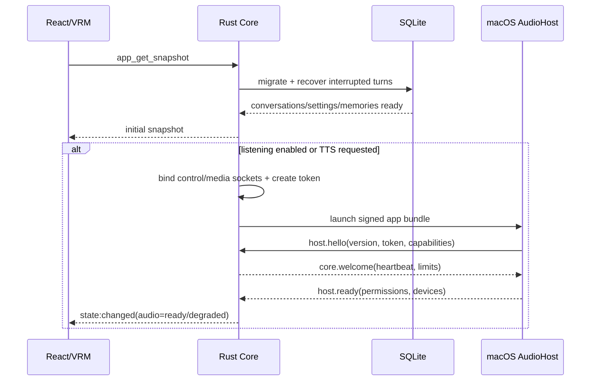
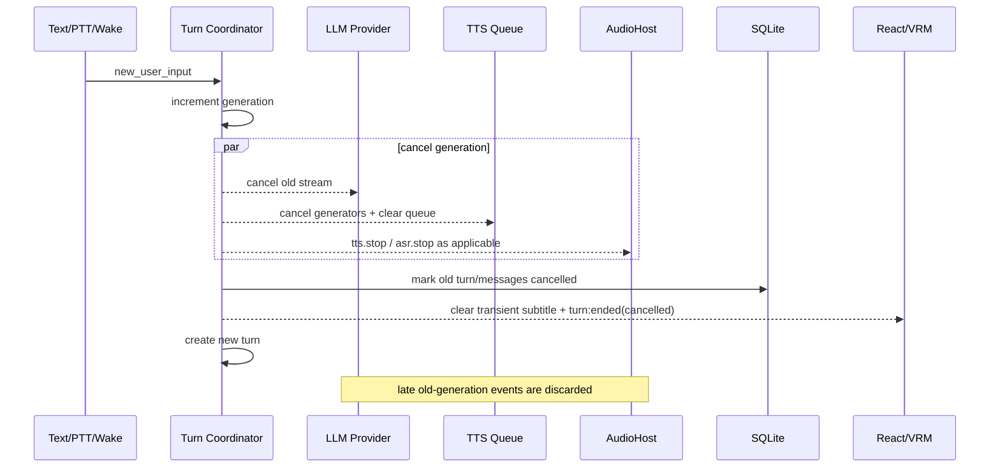
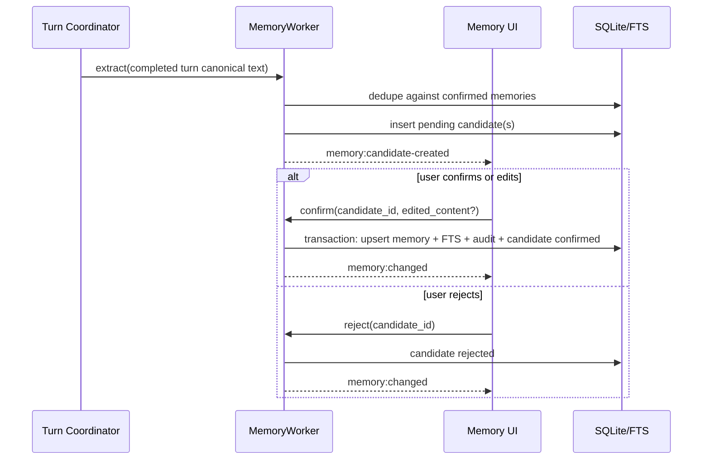

# 关键端到端时序

以下时序是模块间合同。实现可以替换内部算法，但不能绕过 generation guard、终态提交或取消顺序。

## 1. 应用启动与 AudioHost 就绪



数据库失败时不启动需要持久化的 turn；AudioHost 失败时仍允许文本对话。两类故障必须分别呈现。

## 2. 文本对话、流式 TTS 与完成

```mermaid
sequenceDiagram
    participant UI as React/VRM
    participant Core as Turn Coordinator
    participant Mem as Memory Reader
    participant LLM as LLM Provider
    participant TTS as TTS Queue
    participant Host as AudioHost
    participant DB as SQLite

    UI->>Core: chat_submit_text(request_id, text)
    Core->>Core: cancel previous generation; create turn
    Core->>DB: insert turn + completed user message
    Core->>Mem: retrieve confirmed memories within budget
    Mem-->>Core: user + relationship context
    Core->>LLM: start(turn_id, generation, context)
    loop streaming
        LLM-->>Core: TextDelta
        Core-->>UI: turn:text-delta (batched)
        opt sentence boundary
            Core->>TTS: synthesize(chunk_index, canonical, spoken)
            TTS-->>Host: tts.enqueue(next ordered chunk)
            Host-->>Core: tts.chunk_started / level / finished
            Core-->>UI: playback events
        end
    end
    LLM-->>Core: Completed
    Core->>TTS: seal remaining chunk
    TTS-->>Core: playback.drained or playback.not_required
    Core->>DB: commit assistant message + turn completed
    Core-->>UI: turn:message-committed + turn:ended
    Core->>Mem: enqueue memory extraction
```

TTS 失败只使语音降级；已有 LLM 文本仍可完成。LLM 失败则 turn failed，不生成记忆候选。

## 3. 唤醒词语音对话

```mermaid
sequenceDiagram
    participant Host as AudioHost
    participant Audio as Rust Audio Pipeline
    participant Core as Turn Coordinator
    participant UI as React/VRM
    participant ASR as Apple ASR Session

    Host-->>Audio: PCM frames
    Audio->>Audio: pre-roll + KWS
    Audio->>Core: wake.detected(capture_id)
    Core->>Core: cancel active turn and playback
    Core-->>UI: state=listening
    Core->>ASR: capture.start
    ASR-->>Core: capture.started
    Core->>ASR: asr.start(capture_id, generation, pre_roll_ms=800)
    ASR->>ASR: prepend host-local pre-roll; start VAD route
    loop speech
        Host-->>ASR: microphone audio
        ASR-->>Core: asr.partial(revision, full_text)
    Core-->>UI: voice:asr-partial (replace)
    end
    Audio->>Core: speech.ended
    Core->>ASR: asr.finalize
    ASR-->>Core: asr.final(text)
    Core-->>UI: voice:asr-final
    Core->>Core: create text-equivalent turn(source=wake_word)
```

KWS 命中不是用户消息；VAD 结束也不是用户消息。只有非空 `asr.final` 创建 turn。

## 4. 按键说话

```mermaid
sequenceDiagram
    participant Hotkey as Global Shortcut/UI
    participant Core as Rust Core
    participant Host as AudioHost
    participant ASR as ASR Session

    Hotkey->>Core: voice_push_to_talk_start
    Core->>Core: cancel active turn; allocate capture_id
    Core->>Host: capture.start
    Host-->>Core: capture.started
    Core->>Host: asr.start(pre_roll_ms=0)
    Host-->>Core: asr.partial(revision, text)
    Hotkey->>Core: voice_push_to_talk_stop(capture_id)
    Core->>Host: asr.finalize
    Host-->>Core: asr.final(text)
    Core->>Core: submit turn(source=push_to_talk)
```

PTT 可在 ListeningMode=Disabled/QuietHours 使用。快捷键 key-up 丢失时，30 秒硬上限会 finalize；窗口失焦不能自行停止系统级快捷键 capture。

## 5. 新输入打断旧回复



逻辑取消不等待 Host ack 才生效。Host 超时由 AudioHost supervisor 单独处理。

## 6. 记忆候选确认



未确认候选不能被 Context Builder 检索。确认命令按 candidate ID 幂等；重复确认返回同一 memory ID。

## 7. AudioHost 崩溃恢复

```mermaid
sequenceDiagram
    participant Host as AudioHost
    participant Sup as AudioHost Supervisor
    participant Core as State Machines
    participant UI as React/VRM

    Host--xSup: socket EOF / heartbeat timeout
    Sup->>Core: audiohost.disconnected
    Core->>Core: invalidate audio generation; finish sessions once
    Core-->>UI: recovering + text fallback
    loop max 3 attempts
        Sup->>Host: launch with new sockets/token
        Host-->>Sup: hello + ready
    end
    alt recovered
        Sup->>Core: audiohost.ready
        Core-->>UI: restore allowed listening mode
    else exhausted
        Sup->>Core: retry.exhausted
        Core-->>UI: audio unavailable; show retry/settings action
    end
```

恢复不自动重放崩溃前的 ASR partial 或 TTS chunk，避免重复输入和幽灵语音。
