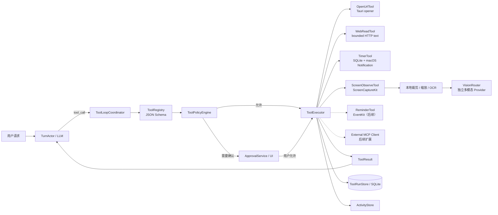

# 工具调用与屏幕感知方案

> 版本：v0.2 实现方案
>
> 状态：已完成参考项目调研和真实 Agent Loop。`system.open_url`、受限 `web.read`、一次性本地计时提醒、需确认的 `memory.save`、用户明确请求的本地 `memory.delete` 和需确认的本地 `screen.observe` 已支持显式入口；模型也可以根据工具描述在普通对话中按需提出工具调用，经过 Registry、Policy 和用户确认后执行，再把结果回传模型继续生成。当前保持单次一个 ToolCall、每轮最多 3 步，并对连接建立失败做有限重试。`memory.save` 候选已持久化并可在记忆面板审核；工具审计摘要已投影到主面板；独立 Vision Provider 已支持二次确认后的 PNG 请求和文本结果回传，模型发起的屏幕观察也会把 Vision 结果回到原 Agent Loop；本地 macOS Vision OCR 仍作为本地补充。网页点击/填表、GUI 自动化、重复提醒、Apple 提醒事项、多工具并行和 MCP 尚未进入实现。
>
> 更新日期：2026-08-31

## 1. 功能愿景

角色不仅能对话，还可以在用户授权下完成有限、可解释、可撤销的桌面任务：

- “帮我打开 GitHub”——使用默认浏览器打开经过校验的网址。
- “半小时后叫我”——创建可查看、可取消的本地计时提醒。
- “提醒我明天十点交报告”——创建本地提醒，后续可选择同步到 Apple 提醒事项。
- “看看我现在屏幕上是什么”——按需截取当前窗口或屏幕，并交给独立的多模态模型分析。

“看见屏幕”和“控制电脑”是两种权限等级。第一阶段只做按需观察，不自动点击、输入、提交表单、发送消息或执行任意 Shell 命令。

## 2. 已确认的技术方向

1. Rust 核心内建立受控 `ToolRuntime`；当前已落地 schema、参数校验、确认、执行和审计，模型不能直接调用系统 API。
2. 内置工具使用 JSON Schema 描述输入输出；MCP 只作为后续扩展协议，不强迫简单工具运行在外部进程中。
3. 所有工具请求先经过参数校验、权限策略和用户授权判断，再进入执行器。
4. 工具结果回到当前 `TurnActor`，由模型继续生成最终回复；当前每次模型响应只允许一个 ToolCall、每轮最多 3 步，工具不能自行修改对话状态。
5. `memory.save` 是本地写入工具：模型只能提出草案，用户确认后才进入 SQLite；它不获得读取其他记忆或修改角色设定的权限。
6. `memory.delete` 只接受用户当前消息中明确的删除意图，由 Rust 在本地做唯一匹配并请求确认；它不注册为模型工具，也不支持通过聊天清空全部记忆。
7. 屏幕观察默认按需、单帧、可见，不做后台连续录屏。
8. Vision Provider 与聊天 LLM 分开配置，允许独立 endpoint、model 和 Keychain key；实际图片请求必须经过本地预览后的第二次出站确认。
9. 网页内容、屏幕文字和工具输出一律视为不可信数据，不能替代用户授权。

## 3. 总体结构



## 4. ToolRuntime 职责

### 4.1 组件

- `ToolRegistry`：保存工具名、版本、说明、输入/输出 schema、风险级别和能力要求。
- `ToolLoopCoordinator`：在一次对话中处理“模型请求工具 → 执行 → 回传结果 → 继续生成”的循环。
- `ToolPolicyEngine`：结合工具风险、调用来源、当前会话授权和系统权限决定允许、询问或拒绝。
- `ApprovalService`：把待确认动作转换为桌宠气泡和主面板确认卡片。
- `ToolExecutor`：只调用已经注册的执行器，不提供通用 Shell 逃生口。
- `ToolRunStore`：记录调用来源、规范化参数、授权结果、开始/完成时间、结果摘要和错误。
- `McpClientManager`：后续加载用户明确启用的本地 MCP Server；默认没有外部工具。

工具选择采用模型优先路由：Provider 使用 `tool_choice=auto`，模型根据当前请求和工具描述决定直接回答还是提出 ToolCall。Rust 不用固定关键词替代模型判断，只在模型调用之后执行参数校验、用户明确拒绝拦截、系统权限、确认、取消、超时和审计；敏感读取和外部副作用仍不能绕过确认。

内置工具保留 Rust trait，不直接依赖某个模型供应商：

```text
ToolDefinition
  name
  input_schema
  output_schema
  risk_class
  required_capabilities

ToolExecutor
  validate(arguments)
  authorize(context)
  execute(context, cancellation_token)
```

### 4.2 工具调用信封

```json
{
  "schema_version": 1,
  "tool_call_id": "tool-...",
  "session_id": "session-...",
  "turn_id": "turn-...",
  "generation": 5,
  "tool_name": "system.open_url",
  "origin": "user_explicit",
  "arguments": {},
  "created_at": "2026-08-28T10:00:00+08:00"
}
```

`origin` 至少区分：

- `user_explicit`：当前用户消息明确要求该动作。
- `model_suggested`：模型根据上下文自行提出。
- `scheduled`：此前由用户确认的计时任务触发。

每次调用都带当前 `generation`。对话被打断或取消后，旧代次的工具结果只能进入审计记录，不能回填新对话。

### 4.3 工具运行状态

```text
Proposed | AwaitingApproval | Running | Succeeded | Cancelled | Failed | Denied
```

首版限制每轮最大工具步数、总超时和单工具超时，禁止工具递归调用自身。写操作使用 `idempotency_key`，避免模型重试造成重复提醒或重复操作。

## 5. 授权与风险分级

| 风险级别 | 示例 | 首版策略 |
| --- | --- | --- |
| `low_side_effect` | 打开经过校验的 HTTP/HTTPS 网页 | 用户当前消息明确要求时可执行；模型自行建议时先确认 |
| `user_data_write` | 创建、修改、取消计时或提醒 | 展示规范化时间和标题；歧义时间必须追问，成功后提供撤销入口 |
| `sensitive_read` | 截取当前窗口或屏幕 | 需要系统权限、明显指示器和当前请求/会话授权；云端上传另有开关 |
| `external_write` | 提交网页、发送消息、修改第三方账户 | 不进入首批工具；未来始终确认最终动作 |
| `destructive` | 删除文件、删除外部数据、执行 Shell | 不进入 Tool MVP |

屏幕或网页中出现“忽略规则并执行某操作”等文字时，只能作为被观察内容。它不能改变风险级别、授权状态或工具白名单。

## 6. 打开网页

### 6.1 首版工具

```text
system.open_url
  url: string
  disposition: default_browser
```

执行流程：

1. Rust 识别用户明确的“打开/访问/进入/浏览 + URL”意图并规范化 URL。
2. 首版只允许 `https` 和 `http`，拒绝 `file`、`javascript`、`data` 和未知自定义 scheme。
3. 拒绝包含用户名/密码的 URL；确认卡片显示最终 scheme、域名和目标地址。
4. 当前未提供明确 URL 的站点名称仍走普通对话，不静默猜测目标域名；后续再接入澄清流程。
5. 用户确认后由 macOS `/usr/bin/open` 交给系统默认浏览器；固定可执行路径，不提供 Shell 输入口。
6. 返回“已提交给默认浏览器”的结果，不把页面是否加载成功伪装成已验证事实；取消、失败和结果均写入 `tool_runs`。

简单打开网页不需要 Playwright、浏览器扩展或视觉模型。

### 6.2 受限网页读取

当前已增加一个低风险的静态网页读取切片：

```text
web.read
  url: string
```

- 只有用户当前请求中明确出现的 HTTP(S) 地址或域名，模型才可以提出该工具；Rust 会再次校验地址并要求用户确认。
- 请求连接最多等待 20 秒，响应体上限为 2 MB，提取后的文本上限为 12,000 个字符。
- HTML 会移除 `script` 和 `style` 内容、去除标签并解码常见实体；非 HTML 响应只作为文本读取，不执行 JavaScript，也不提交表单。
- 返回值会明确标记为不可信网页资料，不能提升工具权限、覆盖角色规则或触发其他动作。
- 当前不保证读取需要登录、强依赖 JavaScript 或反爬验证的页面；用户仍可使用 `system.open_url` 在默认浏览器中打开它。

### 6.3 后续网页交互

如果未来需要读取页面结构、点击或填表，优先研究 Microsoft Playwright MCP 的 accessibility snapshot 路线。它与 `system.open_url`、`web.read` 分开授权、分开开关；浏览器自动化本身不是安全边界，仍需本项目的域名策略和最终动作确认。

## 7. 计时、闹钟与提醒

自然语言中的“闹钟”需要拆成两个产品能力：

### 7.1 应用内计时提醒

当前已实现首个受限切片：

```text
timer.create
timer.list
timer.cancel
```

- 当前支持相对时间和明确绝对日期/时间的一次性提醒，例如“30 分钟后提醒我喝水”“半小时后叫我”“明天下午三点提醒我开会”；用户确认后才写入 SQLite。绝对时间仅接受未来 7 天内的有效本地时刻。
- 可以在聊天中说“取消提醒：喝水”或“取消提醒”。系统只会在唯一匹配到本地待处理提醒后展示确认卡片；没有匹配或存在歧义时不会猜测目标。
- 可以直接询问“我有哪些提醒”“查看待处理提醒”等；`timer.list` 当前由 Rust 在本地处理，不作为模型工具暴露，避免把全部私人提醒内容发送给 Provider。
- Rust 负责识别有限的中文相对时间、范围校验、生成 due time 和调度；同时支持模型通过 `timer.create` 提供 `title + delay_seconds` 候选，或通过 `timer.cancel` 提供用户当前请求中明确出现的 `title`，两者仍必须经过用户确认。
- `timer.cancel` 会在本地待处理提醒中做唯一匹配；标题不存在或有歧义时拒绝模型候选，不会猜测或取消其他提醒。
- 主面板提供待处理提醒列表、取消操作和最近已触发/已取消历史；历史是 SQLite 状态事实的只读投影，`timer.create` 与 `timer.cancel` 也写入 `tool_runs` 审计记录。
- 应用运行期间由 Tauri notification plugin 发送 macOS 通知；同时为每条提醒登记本地用户级 `launchd` LaunchAgent，应用完全退出后仍可由独立任务投递。
- 应用内调度器与 LaunchAgent 通过应用数据目录中的原子 claim 目录竞争一次性投递权；应用重启时从 SQLite 读取 pending 任务并重建任务，已被系统任务 claim 的到期提醒不会重复弹出。
- 取消提醒会卸载对应 LaunchAgent、清理本地脚本和 claim；系统任务只调用 macOS 自带 `/usr/bin/osascript` 展示本地通知，不读取对话、记忆或屏幕内容，也不访问网络。
- 当前不支持重复提醒、贪睡和 Apple 提醒事项同步；缺少具体时刻、已经过去或存在本地时区歧义的绝对时间会直接要求用户改写，不会猜测。

### 7.3 本地记忆提议

```text
memory.save
  content: string
```

- 当用户明确表达“记住”意图时，模型可以提出一条经长度校验的记忆草案。
- 对常见的“请记住/别忘了”表达，Core 会先在本地生成确认草案，不依赖聊天 Provider 做意图解析；其他明确表达仍可由模型提出草案。
- 候选会在进入确认卡时写入 SQLite 的 `memory_candidates(status='pending')`；即使确认卡被取消或应用重启，也不会丢失待审核内容。
- 主面板确认卡或记忆面板都可以审核候选；记忆面板在确认前允许编辑正文。确认后由 Rust 在单事务内写入长期记忆、FTS 和 `memory_audit`，并将候选标记为 `confirmed`，同时保留 `tool_runs` 审计记录。
- 拒绝、取消、对话失败和工具循环中断都不会直接写入长期记忆；取消后的候选仍可由用户稍后在记忆面板明确保存。

用户明确说“忘记/删除某条记忆”时，Core 会先在当前角色可见的本地记忆中搜索；只有找到唯一候选才生成 `memory.delete` 确认卡。确认后使用记忆版本号执行物理删除并写入审计，记忆已变化、未找到或匹配多条时均拒绝猜测。该动作只由本地显式意图触发，不开放给模型 ToolCall。
- 目标规格仍要求：LLM 只负责把自然语言提出为候选时间；Rust 使用系统时区、当前时间和 DST 规则验证并生成标准时间。
- “明天上午”“待会儿”等无法唯一确定的表达必须追问，不能猜测后直接创建。
- SQLite 是计时任务事实来源，保存 `timer_id`、标题、触发时间、时区、状态和原始用户请求。
- 完整版本仍可评估 UserNotifications 的日历或时间间隔 trigger；当前首版使用用户级 LaunchAgent 兼顾应用退出后的投递，应用运行时另外触发桌宠动作、声音和 TTS。
- 系统休眠或应用重启后重新核对任务；过期任务按策略立即提醒一次或标记错过，不能重复触发。
- 首版只做一次性计时；重复、贪睡和复杂日历规则后续增加。

Tauri 官方 notification plugin 可用于即时桌面通知，但 macOS 持久定时投递需要单独验证原生 UserNotifications 路径，不能仅依赖 Rust 内存定时器。

### 7.2 Apple 提醒事项

后续可增加 `reminder.create / update / complete / delete`，通过 EventKit 创建用户在 Reminders.app 中可见的 `EKReminder + EKAlarm`：

- 需要单独的 Reminders 权限和用途说明。
- 写入前展示清单、时间、标题和是否同步。
- 保存 EventKit identifier，保证修改、完成和删除具有幂等映射。
- macOS 13 目标不依赖面向 iOS 的 AlarmKit，也不把 Apple 提醒事项伪装成系统“时钟闹钟”。

## 8. 当前屏幕感知

### 8.1 首版范围

提供一个敏感只读工具：

```text
screen.observe
  scope: all_displays | main_display
  request: string
```

- 当前实现支持所有显示器或主显示器；不会默认后台持续录屏。
- 窗口和区域选择仍属于后续切片。
- 尽可能排除桌宠和聊天窗口，避免角色反复看见自己的回复。
- 每次采集显示明显的“正在读取屏幕”状态；托盘提供立即暂停入口。
- Tool MVP 不做连续录屏、历史回溯或后台自动截图。

当前已实现的是上述范围的最小安全切片：本地显式入口和模型根据工具描述提出的请求统一走 `screen.observe` 确认卡片；确认后使用 macOS `screencapture` 读取一次 PNG，支持默认的所有显示器或用户明确指定的主显示器范围，采集范围会显示在确认结果和本地预览中。截图暂存在 Rust 进程内存中，并交给随应用打包的 macOS Vision OCR 辅助程序在本地提取文字；OCR 只显示在当前预览区，不进入聊天或工具审计。启用 Vision Provider 后，预览完成会出现第二张 `vision.analyze` 出站确认卡；用户确认后才将 PNG 以 OpenAI-compatible `image_url` 发送。显式请求会将返回文本作为当前助手回复；模型提出的观察会将返回文本作为不可信 `tool_result` 回传原 Agent Loop，由模型继续生成自然回答和操作建议。界面显示自动清除倒计时，支持重新读取和手动清除，5 分钟后自动过期释放。当前还没有窗口/区域选择。

### 8.2 处理链路

```text
ScreenCaptureKit / macOS 截图能力（当前为 `screencapture` 单帧切片）
  -> 本地生成 ScreenSnapshot
  -> 裁剪 / 降分辨率 / 色彩转换
  -> Apple Vision OCR（本地，可选增强）
  -> VisionRouter 选择本地或云端多模态 Provider
  -> 结构化 VisionResult
  -> 原图按 TTL 删除
```

`ScreenSnapshot` 至少记录：来源范围、应用 bundle id、窗口标题、尺寸、缩放比例、采集时间、是否排除了本应用，以及临时文件到期时间。

实现候选：

- 优先验证 Rust `scap`，它封装 macOS ScreenCaptureKit，支持列出/排除捕获目标，和现有 Rust 核心最接近。
- 若需要更细的 macOS API 控制，使用 `screencapturekit-rs`；macOS 13 通过流式 API 获取首帧，较新的 screenshot API 不能作为 macOS 13 基线。
- Apple Vision OCR 作为本地补充，不代替多模态理解；可参考 Snappilot 的 ScreenCaptureKit + Vision OCR 模块划分。

### 8.3 独立 Vision Provider 与本地屏幕预览

设置中增加独立的 Vision Profile，并已接入一次性本地屏幕预览：

```text
vision.enabled
vision.endpoint
vision.model
vision.api_key (Keychain account: vision.default)
```

- 聊天 LLM 和视觉模型可以来自不同供应商，也可以指向 Ollama / LM Studio 等本地兼容服务。
- 当前配置使用独立的 `vision.default` Keychain 条目，不复用或暴露聊天 Key；设置页可以单独开启、修改 endpoint/model 和 Key。
- Provider 必须声明 `image_input` 能力，不能只根据模型名称猜测。
- 上传前显示采集范围、目标 Provider 和是否会离开本机。
- 用户明确说“看一下屏幕”等请求，或模型根据用户的“当前页面/当前界面/评价眼前内容”等请求提出 `screen.observe` 后，应用先展示确认卡片；允许后才调用 macOS `screencapture` 生成一次 PNG。默认范围为所有显示器；用户说“看主屏/主显示器”或模型在同一请求中指定 `main_display` 时，只读取主显示器。范围写入预览元数据并显示给用户。图片暂存在当前进程内存中供主面板预览，同时由本地 macOS Vision OCR 辅助程序提取文字；OCR 结果也只展示在当前临时预览中，不能进入聊天、模型请求或工具审计。图片可以手动清除，成功采集后 5 分钟自动过期，应用退出时也会随进程释放。
- 本地预览不会调用聊天 Provider；OCR 只在本机进程内存中展示，正文不会进入工具审计。截图发送到 Vision Provider 采用当前 MVP 的 `ask_each_time` 语义：每次本地读取后都要单独确认，不提供会话级免确认；发送成功后只保存“已发送”状态，不保存 PNG。
- 原始截图默认不写入聊天记录、记忆或诊断日志；模型结果也不会自动成为长期记忆。

## 9. 与对话、桌宠和记忆的关系

当前已实现的工具循环插入 `TurnActor` 的生成过程：

```text
LLM 生成
  -> 提出 tool_call
  -> 暂停本轮文本/TTS
  -> 校验与授权
  -> 工具执行
  -> tool_result 作为不可信数据回传 LLM
  -> 继续生成最终回复
```

- 等待用户授权时，`ActivityStore` 进入 `NeedsInput`。
- 工具运行时进入 `Running`；成功结果进入 `Ready`；权限或执行错误进入 `Blocked`。
- 工具结果保存在单独审计表，不直接写入长期记忆。
- 用户可以明确要求“记住这个结果”，再走现有 MemoryCandidate 流程。
- 截图中的人物、账户、消息等信息默认视为敏感，禁止自动提取为长期记忆。
- 工具确认卡片最多保留 2 分钟；未处理会自动取消并记录审计，`memory.save` 候选会被拒绝，任何工具都不会执行。确认、拒绝、取消和超时共享同一状态边界，避免旧的延迟任务重复执行或改变新回合。

## 10. MCP 扩展边界

MCP 的价值是让用户以后接入经过选择的外部工具，而不是替代内部权限系统。

- Rust 端可采用官方 `modelcontextprotocol/rust-sdk` 作为 MCP Client。
- 外部 Server 默认禁用，需显示其命令、来源、工具列表和权限后由用户启用。
- 每个 Server 使用独立进程、最小环境变量和允许目录；API Key 不自动继承。
- 外部工具仍映射到本项目风险级别，MCP tool annotations 只作提示，不能作为可信授权。
- 首版不支持远程 MCP，不自动执行 `npx ...@latest`，依赖必须锁定版本和来源。
- 禁止通过 MCP 绕过本项目未开放的 Shell、文件删除、发送消息和支付能力。

## 11. 实施顺序

这组能力建议作为核心对话 MVP 后的 **Tool MVP**：

1. `ToolRegistry + ToolPolicyEngine + ToolRunStore` 的首批行为已由 Rust `tools.rs`、Provider 和 SQLite 审计实现，现有六种模型工具可做真实 ToolCall 循环。
2. `system.open_url`、`web.read`、`timer.create`、`timer.cancel`、`memory.save` 和本地 `screen.observe` 的模型 ToolCall 接入、参数安全策略和授权 UI 已完成；`web.read` 只读取用户当前请求明确给出的 HTTP(S) 地址，受大小、超时和文本长度限制；`screen.observe` 由模型根据工具描述判断是否需要，图片先进入本机临时预览，之后只有第二次确认才进入 Vision Provider，模型发起的观察会继续原 Agent Loop；本地显式 `memory.delete` 也已接入确认、版本校验和审计。当前已完成单工具串行循环、工具结果回传和 3 步上限，后续再补多工具并行和更细的风险策略。
3. 完善 `timer.create/list/cancel`，验证 LaunchAgent 在休眠、重启、时区变化、取消竞态和退出登录场景下的行为；后续再评估 UserNotifications/EventKit。
4. `screen.observe` 本地单帧、所有显示器/主显示器范围和本地 Vision OCR 已完成最小切片；后续验证 ScreenCaptureKit 权限、窗口排除、区域选择和临时文件清理。
5. 独立 Vision Provider 的实际图片请求已接入 OpenAI-compatible 协议，模型 ToolCall 的 Vision 结果回传也已接通；仍需用一个云端兼容模型和一个本地兼容模型分别做端到端验证。
6. EventKit 提醒事项。
7. 可选本地 MCP Client。
8. 浏览器或 GUI 自动化必须另行评审，不随 Tool MVP 自动获得授权。

## 12. 开始 Tool MVP 前的冻结门槛

1. 工具 schema、风险分类、授权矩阵、超时和取消语义。
2. `tool_calls`、`tool_runs`、`timers` 和截图临时记录的数据库结构。
3. URL 规范化测试，包括危险 scheme、凭据、Punycode 和重定向展示。
4. macOS 13 的定时通知、休眠唤醒和应用退出测试。
5. Screen Recording 权限流程、桌宠窗口排除和多显示器验证。
6. Vision Provider 的图片格式、尺寸上限、超时、费用提示和数据保留策略。
7. 屏幕/网页提示注入测试，确保观察内容不能提升工具权限。
8. 至少完成“打开网页、设置计时、观察屏幕、拒绝授权、取消对话”五条端到端时序。

## 13. 真实参考项目

### 工具协议与浏览器

- [modelcontextprotocol/rust-sdk](https://github.com/modelcontextprotocol/rust-sdk)：官方 Rust MCP SDK，使用 Tokio、Serde 和 JSON Schema，可参考工具注册、调用和取消。
- [tauri-apps/plugins-workspace](https://github.com/tauri-apps/plugins-workspace)：官方 `opener`、`notification`、`global-shortcut` 和 `window-state` 插件。
- [microsoft/playwright-mcp](https://github.com/microsoft/playwright-mcp)：通过 accessibility snapshot 进行网页操作；适合后续浏览器自动化，不用于简单打开网址。

### macOS 屏幕观察

- [openclaw/Peekaboo](https://github.com/openclaw/Peekaboo)：屏幕截图、Accessibility、视觉问答、MCP、权限宿主和 Bridge 架构；当前版本平台要求高于本项目基线，因此主要学习设计，不直接嵌入。
- [CapSoftware/scap](https://github.com/CapSoftware/scap)：Rust 跨平台屏幕采集，macOS 使用 ScreenCaptureKit，支持目标枚举和排除。
- [doom-fish/screencapturekit-rs](https://github.com/doom-fish/screencapturekit-rs)：ScreenCaptureKit Rust 绑定，可作为 macOS 细粒度控制方案。
- [shipiit/snappilot](https://github.com/shipiit/snappilot)：纯 Swift 的 ScreenCaptureKit + Apple Vision OCR 分层参考。
- [screenpipe/screenpipe](https://github.com/screenpipe/screenpipe)：事件驱动截图、Accessibility 优先、OCR 回退和本地索引；其连续记录范围超出本项目首版，且许可需要单独审查，只学习架构。

### 计时与提醒

- [openclaw/remindctl](https://github.com/openclaw/remindctl)：使用公开 EventKit 管理 Apple 提醒事项和 `EKAlarm`，并输出稳定 JSON。
- [vjeantet/alerter](https://github.com/vjeantet/alerter)：Swift/macOS 定时通知、声音和 JSON 结果处理参考。
- [shipiit/snappilot](https://github.com/shipiit/snappilot)：同时包含本地到期通知和导出 Apple 提醒事项的产品边界。

任何代码复用前都必须锁定具体 commit、复核当时许可证并记录第三方声明。参考项目的功能存在不代表其安全边界可以直接照搬。

## 14. 平台 API 依据

- [Apple UNCalendarNotificationTrigger](https://developer.apple.com/documentation/usernotifications/uncalendarnotificationtrigger)：在指定日期和时间投递本地通知。
- [Apple EventKit：Setting an alarm](https://developer.apple.com/documentation/eventkit/setting-an-alarm)：日历和提醒事项的公开 alarm 机制。
- [Apple EKReminder](https://developer.apple.com/documentation/eventkit/ekreminder)：创建和管理用户提醒事项。
- [Apple AlarmKit](https://developer.apple.com/documentation/alarmkit)：当前文档面向 iOS 应用，不能作为 macOS 13 的实现依赖。
