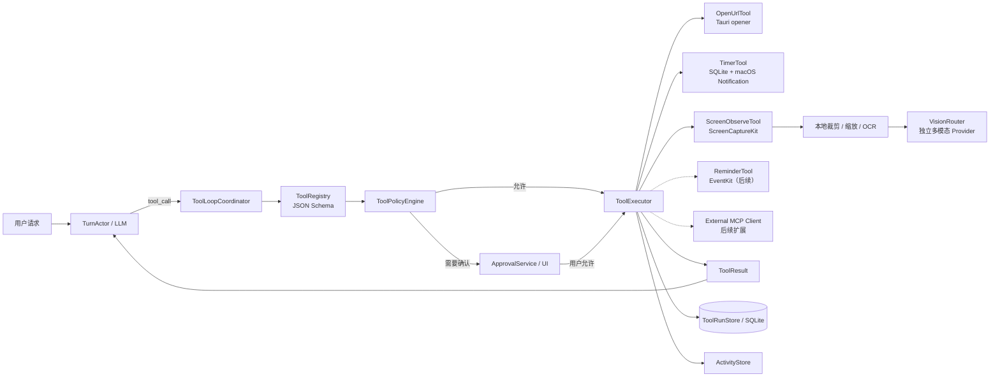

# 工具调用与屏幕感知方案

> 版本：v0.1 规划方案
>
> 状态：已完成参考项目调研；`system.open_url`、一次性本地计时提醒、需确认的 `memory.save`、模型提议的 `timer.cancel` 和需确认的本地 `screen.observe` 已支持显式意图或 OpenAI-compatible 单次单个模型 ToolCall（每轮最多 3 步）；独立 Vision Provider 配置已落地，但截图发送、视觉分析、多工具并行和其余 Tool MVP 尚未进入实现
>
> 更新日期：2026-08-29

## 1. 功能愿景

角色不仅能对话，还可以在用户授权下完成有限、可解释、可撤销的桌面任务：

- “帮我打开 GitHub”——使用默认浏览器打开经过校验的网址。
- “半小时后叫我”——创建可查看、可取消的本地计时提醒。
- “提醒我明天十点交报告”——创建本地提醒，后续可选择同步到 Apple 提醒事项。
- “看看我现在屏幕上是什么”——按需截取当前窗口或屏幕，并交给独立的多模态模型分析。

“看见屏幕”和“控制电脑”是两种权限等级。第一阶段只做按需观察，不自动点击、输入、提交表单、发送消息或执行任意 Shell 命令。

## 2. 已确认的技术方向

1. Rust 核心内建立受控 `ToolRuntime`；当前已落地 schema、参数校验、确认、执行和审计，模型不能直接调用系统 API。
2. 内置工具使用 JSON Schema 描述输入输出；MCP 只作为后续扩展协议，不强迫简单工具运行在外部进程中。
3. 所有工具请求先经过参数校验、权限策略和用户授权判断，再进入执行器。
4. 工具结果回到当前 `TurnActor`，由模型继续生成最终回复；当前每次模型响应只允许一个 ToolCall、每轮最多 3 步，工具不能自行修改对话状态。
5. `memory.save` 是本地写入工具：模型只能提出草案，用户确认后才进入 SQLite；它不获得读取其他记忆或修改角色设定的权限。
6. 屏幕观察默认按需、单帧、可见，不做后台连续录屏。
7. Vision Provider 与聊天 LLM 分开配置，允许独立 endpoint、model 和 Keychain key；当前已经落地配置保存，实际图片请求仍需单独接入。
8. 网页内容、屏幕文字和工具输出一律视为不可信数据，不能替代用户授权。

## 3. 总体结构



## 4. ToolRuntime 职责

### 4.1 组件

- `ToolRegistry`：保存工具名、版本、说明、输入/输出 schema、风险级别和能力要求。
- `ToolLoopCoordinator`：在一次对话中处理“模型请求工具 → 执行 → 回传结果 → 继续生成”的循环。
- `ToolPolicyEngine`：结合工具风险、调用来源、当前会话授权和系统权限决定允许、询问或拒绝。
- `ApprovalService`：把待确认动作转换为桌宠气泡和主面板确认卡片。
- `ToolExecutor`：只调用已经注册的执行器，不提供通用 Shell 逃生口。
- `ToolRunStore`：记录调用来源、规范化参数、授权结果、开始/完成时间、结果摘要和错误。
- `McpClientManager`：后续加载用户明确启用的本地 MCP Server；默认没有外部工具。

内置工具保留 Rust trait，不直接依赖某个模型供应商：

```text
ToolDefinition
  name
  input_schema
  output_schema
  risk_class
  required_capabilities

ToolExecutor
  validate(arguments)
  authorize(context)
  execute(context, cancellation_token)
```

### 4.2 工具调用信封

```json
{
  "schema_version": 1,
  "tool_call_id": "tool-...",
  "session_id": "session-...",
  "turn_id": "turn-...",
  "generation": 5,
  "tool_name": "system.open_url",
  "origin": "user_explicit",
  "arguments": {},
  "created_at": "2026-08-28T10:00:00+08:00"
}
```

`origin` 至少区分：

- `user_explicit`：当前用户消息明确要求该动作。
- `model_suggested`：模型根据上下文自行提出。
- `scheduled`：此前由用户确认的计时任务触发。

每次调用都带当前 `generation`。对话被打断或取消后，旧代次的工具结果只能进入审计记录，不能回填新对话。

### 4.3 工具运行状态

```text
Proposed | AwaitingApproval | Running | Succeeded | Cancelled | Failed | Denied
```

首版限制每轮最大工具步数、总超时和单工具超时，禁止工具递归调用自身。写操作使用 `idempotency_key`，避免模型重试造成重复提醒或重复操作。

## 5. 授权与风险分级

| 风险级别 | 示例 | 首版策略 |
| --- | --- | --- |
| `low_side_effect` | 打开经过校验的 HTTP/HTTPS 网页 | 用户当前消息明确要求时可执行；模型自行建议时先确认 |
| `user_data_write` | 创建、修改、取消计时或提醒 | 展示规范化时间和标题；歧义时间必须追问，成功后提供撤销入口 |
| `sensitive_read` | 截取当前窗口或屏幕 | 需要系统权限、明显指示器和当前请求/会话授权；云端上传另有开关 |
| `external_write` | 提交网页、发送消息、修改第三方账户 | 不进入首批工具；未来始终确认最终动作 |
| `destructive` | 删除文件、删除外部数据、执行 Shell | 不进入 Tool MVP |

屏幕或网页中出现“忽略规则并执行某操作”等文字时，只能作为被观察内容。它不能改变风险级别、授权状态或工具白名单。

## 6. 打开网页

### 6.1 首版工具

```text
system.open_url
  url: string
  disposition: default_browser
```

执行流程：

1. Rust 识别用户明确的“打开/访问/进入/浏览 + URL”意图并规范化 URL。
2. 首版只允许 `https` 和 `http`，拒绝 `file`、`javascript`、`data` 和未知自定义 scheme。
3. 拒绝包含用户名/密码的 URL；确认卡片显示最终 scheme、域名和目标地址。
4. 当前未提供明确 URL 的站点名称仍走普通对话，不静默猜测目标域名；后续再接入澄清流程。
5. 用户确认后由 macOS `/usr/bin/open` 交给系统默认浏览器；固定可执行路径，不提供 Shell 输入口。
6. 返回“已提交给默认浏览器”的结果，不把页面是否加载成功伪装成已验证事实；取消、失败和结果均写入 `tool_runs`。

简单打开网页不需要 Playwright、浏览器扩展或视觉模型。

### 6.2 后续网页交互

如果未来需要读取页面结构、点击或填表，优先研究 Microsoft Playwright MCP 的 accessibility snapshot 路线。它与 `system.open_url` 分开授权、分开开关；浏览器自动化本身不是安全边界，仍需本项目的域名策略和最终动作确认。

## 7. 计时、闹钟与提醒

自然语言中的“闹钟”需要拆成两个产品能力：

### 7.1 应用内计时提醒

当前已实现首个受限切片：

```text
timer.create
timer.list
timer.cancel
```

- 当前支持相对时间的一次性提醒，例如“30 分钟后提醒我喝水”“半小时后叫我”；用户确认后才写入 SQLite。
- 可以在聊天中说“取消提醒：喝水”或“取消提醒”。系统只会在唯一匹配到本地待处理提醒后展示确认卡片；没有匹配或存在歧义时不会猜测目标。
- Rust 负责识别有限的中文相对时间、范围校验、生成 due time 和调度；同时支持模型通过 `timer.create` 提供 `title + delay_seconds` 候选，或通过 `timer.cancel` 提供用户当前请求中明确出现的 `title`，两者仍必须经过用户确认。
- `timer.cancel` 会在本地待处理提醒中做唯一匹配；标题不存在或有歧义时拒绝模型候选，不会猜测或取消其他提醒。
- 主面板提供待处理提醒列表和取消操作；`timer.create` 与 `timer.cancel` 也写入 `tool_runs` 审计记录。
- 应用运行期间由 Tauri notification plugin 发送 macOS 通知；应用重启后会重新读取 pending 任务，并对已到期任务只触发一次。
- 应用完全退出时不会由系统独立投递通知；要覆盖该场景，需要后续接入 macOS 原生 UserNotifications 日历/时间间隔 trigger，并增加休眠、时区和桌宠动作验证。
- 当前不支持绝对日期、重复提醒、贪睡和 Apple 提醒事项同步。

### 7.3 本地记忆提议

```text
memory.save
  content: string
```

- 当用户明确表达“记住”意图时，模型可以提出一条经长度校验的记忆草案。
- 对常见的“请记住/别忘了”表达，Core 会先在本地生成确认草案，不依赖聊天 Provider 做意图解析；其他明确表达仍可由模型提出草案。
- 主面板确认卡显示待保存内容；确认后由 Rust 调用本地记忆仓库写入 SQLite，并保留 `tool_runs` 审计记录。
- 拒绝、取消、对话失败和工具循环中断都不会写入长期记忆。
- 目标规格仍要求：LLM 只负责把自然语言提出为候选时间；Rust 使用系统时区、当前时间和 DST 规则验证并生成标准时间。
- “明天上午”“待会儿”等无法唯一确定的表达必须追问，不能猜测后直接创建。
- SQLite 是计时任务事实来源，保存 `timer_id`、标题、触发时间、时区、状态和原始用户请求。
- 完整版本应使用 UserNotifications 的日历或时间间隔 trigger 注册本地通知；应用运行时同时触发桌宠动作、声音和 TTS。
- 系统休眠或应用重启后重新核对任务；过期任务按策略立即提醒一次或标记错过，不能重复触发。
- 首版只做一次性计时；重复、贪睡和复杂日历规则后续增加。

Tauri 官方 notification plugin 可用于即时桌面通知，但 macOS 持久定时投递需要单独验证原生 UserNotifications 路径，不能仅依赖 Rust 内存定时器。

### 7.2 Apple 提醒事项

后续可增加 `reminder.create / update / complete / delete`，通过 EventKit 创建用户在 Reminders.app 中可见的 `EKReminder + EKAlarm`：

- 需要单独的 Reminders 权限和用途说明。
- 写入前展示清单、时间、标题和是否同步。
- 保存 EventKit identifier，保证修改、完成和删除具有幂等映射。
- macOS 13 目标不依赖面向 iOS 的 AlarmKit，也不把 Apple 提醒事项伪装成系统“时钟闹钟”。

## 8. 当前屏幕感知

### 8.1 首版范围

提供一个敏感只读工具：

```text
screen.observe
  scope: frontmost_window | current_display | selected_region
  question: string
  include_ocr: boolean
```

- 默认 `frontmost_window`，避免无必要地采集全部显示器。
- 用户可显式选择当前显示器或区域。
- 尽可能排除桌宠和聊天窗口，避免角色反复看见自己的回复。
- 每次采集显示明显的“正在读取屏幕”状态；托盘提供立即暂停入口。
- Tool MVP 不做连续录屏、历史回溯或后台自动截图。

当前已实现的是上述范围的最小安全切片：仅接受显式中文观察意图，统一走 `screen.observe` 确认卡片；确认后使用 macOS `screencapture` 读取一次整屏 PNG，暂存在 Rust 进程内存中供主面板预览。当前还没有窗口/显示器/区域选择，截图也不会发送给任何模型。

### 8.2 处理链路

```text
ScreenCaptureKit / macOS 截图能力（当前为 `screencapture` 单帧切片）
  -> 本地生成 ScreenSnapshot
  -> 裁剪 / 降分辨率 / 色彩转换
  -> 可选 Apple Vision OCR
  -> VisionRouter 选择本地或云端多模态 Provider
  -> 结构化 VisionResult
  -> 原图按 TTL 删除
```

`ScreenSnapshot` 至少记录：来源范围、应用 bundle id、窗口标题、尺寸、缩放比例、采集时间、是否排除了本应用，以及临时文件到期时间。

实现候选：

- 优先验证 Rust `scap`，它封装 macOS ScreenCaptureKit，支持列出/排除捕获目标，和现有 Rust 核心最接近。
- 若需要更细的 macOS API 控制，使用 `screencapturekit-rs`；macOS 13 通过流式 API 获取首帧，较新的 screenshot API 不能作为 macOS 13 基线。
- Apple Vision OCR 作为本地补充，不代替多模态理解；可参考 Snappilot 的 ScreenCaptureKit + Vision OCR 模块划分。

### 8.3 独立 Vision Provider 与本地屏幕预览

设置中增加独立的 Vision Profile，并已接入一次性本地屏幕预览：

```text
vision.enabled
vision.endpoint
vision.model
vision.api_key (Keychain account: vision.default)
```

- 聊天 LLM 和视觉模型可以来自不同供应商，也可以指向 Ollama / LM Studio 等本地兼容服务。
- 当前配置使用独立的 `vision.default` Keychain 条目，不复用或暴露聊天 Key；设置页可以单独开启、修改 endpoint/model 和 Key。
- Provider 必须声明 `image_input` 能力，不能只根据模型名称猜测。
- 上传前显示采集范围、目标 Provider 和是否会离开本机。
- 用户明确说“看一下屏幕”等请求后，应用先展示 `screen.observe` 确认卡片；允许后才调用 macOS `screencapture` 生成一次 PNG，并把图片暂存在当前进程内存中供主面板预览。图片可以手动清除，应用退出时也会随进程释放。
- 当前本地预览不会调用聊天 Provider 或 Vision Provider；截图尚未上传或分析，后续仍需增加 `never | ask_each_time | allow_for_session` 数据发送策略，并在“发送给视觉模型”前单独确认。
- 原始截图默认不写入聊天记录、记忆或诊断日志；模型结果也不会自动成为长期记忆。

## 9. 与对话、桌宠和记忆的关系

当前已实现的工具循环插入 `TurnActor` 的生成过程：

```text
LLM 生成
  -> 提出 tool_call
  -> 暂停本轮文本/TTS
  -> 校验与授权
  -> 工具执行
  -> tool_result 作为不可信数据回传 LLM
  -> 继续生成最终回复
```

- 等待用户授权时，`ActivityStore` 进入 `NeedsInput`。
- 工具运行时进入 `Running`；成功结果进入 `Ready`；权限或执行错误进入 `Blocked`。
- 工具结果保存在单独审计表，不直接写入长期记忆。
- 用户可以明确要求“记住这个结果”，再走现有 MemoryCandidate 流程。
- 截图中的人物、账户、消息等信息默认视为敏感，禁止自动提取为长期记忆。

## 10. MCP 扩展边界

MCP 的价值是让用户以后接入经过选择的外部工具，而不是替代内部权限系统。

- Rust 端可采用官方 `modelcontextprotocol/rust-sdk` 作为 MCP Client。
- 外部 Server 默认禁用，需显示其命令、来源、工具列表和权限后由用户启用。
- 每个 Server 使用独立进程、最小环境变量和允许目录；API Key 不自动继承。
- 外部工具仍映射到本项目风险级别，MCP tool annotations 只作提示，不能作为可信授权。
- 首版不支持远程 MCP，不自动执行 `npx ...@latest`，依赖必须锁定版本和来源。
- 禁止通过 MCP 绕过本项目未开放的 Shell、文件删除、发送消息和支付能力。

## 11. 实施顺序

这组能力建议作为核心对话 MVP 后的 **Tool MVP**：

1. `ToolRegistry + ToolPolicyEngine + ToolRunStore` 的首批行为已由 Rust Provider/Tool 分支实现，现有四种模型工具可做真实 ToolCall 循环。
2. `system.open_url`、`timer.create`、`timer.cancel` 和 `memory.save` 的模型 ToolCall 接入、参数安全策略和授权 UI 已完成；仍需抽成独立 Registry/Policy 模块并补多工具循环。
3. 完善 `timer.create/list/cancel`，接入系统级离线通知并验证休眠、重启、时区和重复触发。
4. `screen.observe` 本地单帧已完成最小切片；后续验证 ScreenCaptureKit 权限、窗口排除、显示器/区域选择和临时文件清理。
5. 独立 Vision Provider 的实际图片请求，先接一个云端兼容模型和一个本地兼容模型；当前仅完成配置与 Keychain 隔离。
6. EventKit 提醒事项。
7. 可选本地 MCP Client。
8. 浏览器或 GUI 自动化必须另行评审，不随 Tool MVP 自动获得授权。

## 12. 开始 Tool MVP 前的冻结门槛

1. 工具 schema、风险分类、授权矩阵、超时和取消语义。
2. `tool_calls`、`tool_runs`、`timers` 和截图临时记录的数据库结构。
3. URL 规范化测试，包括危险 scheme、凭据、Punycode 和重定向展示。
4. macOS 13 的定时通知、休眠唤醒和应用退出测试。
5. Screen Recording 权限流程、桌宠窗口排除和多显示器验证。
6. Vision Provider 的图片格式、尺寸上限、超时、费用提示和数据保留策略。
7. 屏幕/网页提示注入测试，确保观察内容不能提升工具权限。
8. 至少完成“打开网页、设置计时、观察屏幕、拒绝授权、取消对话”五条端到端时序。

## 13. 真实参考项目

### 工具协议与浏览器

- [modelcontextprotocol/rust-sdk](https://github.com/modelcontextprotocol/rust-sdk)：官方 Rust MCP SDK，使用 Tokio、Serde 和 JSON Schema，可参考工具注册、调用和取消。
- [tauri-apps/plugins-workspace](https://github.com/tauri-apps/plugins-workspace)：官方 `opener`、`notification`、`global-shortcut` 和 `window-state` 插件。
- [microsoft/playwright-mcp](https://github.com/microsoft/playwright-mcp)：通过 accessibility snapshot 进行网页操作；适合后续浏览器自动化，不用于简单打开网址。

### macOS 屏幕观察

- [openclaw/Peekaboo](https://github.com/openclaw/Peekaboo)：屏幕截图、Accessibility、视觉问答、MCP、权限宿主和 Bridge 架构；当前版本平台要求高于本项目基线，因此主要学习设计，不直接嵌入。
- [CapSoftware/scap](https://github.com/CapSoftware/scap)：Rust 跨平台屏幕采集，macOS 使用 ScreenCaptureKit，支持目标枚举和排除。
- [doom-fish/screencapturekit-rs](https://github.com/doom-fish/screencapturekit-rs)：ScreenCaptureKit Rust 绑定，可作为 macOS 细粒度控制方案。
- [shipiit/snappilot](https://github.com/shipiit/snappilot)：纯 Swift 的 ScreenCaptureKit + Apple Vision OCR 分层参考。
- [screenpipe/screenpipe](https://github.com/screenpipe/screenpipe)：事件驱动截图、Accessibility 优先、OCR 回退和本地索引；其连续记录范围超出本项目首版，且许可需要单独审查，只学习架构。

### 计时与提醒

- [openclaw/remindctl](https://github.com/openclaw/remindctl)：使用公开 EventKit 管理 Apple 提醒事项和 `EKAlarm`，并输出稳定 JSON。
- [vjeantet/alerter](https://github.com/vjeantet/alerter)：Swift/macOS 定时通知、声音和 JSON 结果处理参考。
- [shipiit/snappilot](https://github.com/shipiit/snappilot)：同时包含本地到期通知和导出 Apple 提醒事项的产品边界。

任何代码复用前都必须锁定具体 commit、复核当时许可证并记录第三方声明。参考项目的功能存在不代表其安全边界可以直接照搬。

## 14. 平台 API 依据

- [Apple UNCalendarNotificationTrigger](https://developer.apple.com/documentation/usernotifications/uncalendarnotificationtrigger)：在指定日期和时间投递本地通知。
- [Apple EventKit：Setting an alarm](https://developer.apple.com/documentation/eventkit/setting-an-alarm)：日历和提醒事项的公开 alarm 机制。
- [Apple EKReminder](https://developer.apple.com/documentation/eventkit/ekreminder)：创建和管理用户提醒事项。
- [Apple AlarmKit](https://developer.apple.com/documentation/alarmkit)：当前文档面向 iOS 应用，不能作为 macOS 13 的实现依赖。
